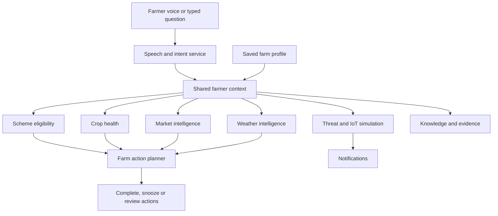

# Jeevandhara

**Speak to Your Farm. Let Intelligence Do the Rest.**

Jeevandhara is a voice-first agricultural decision and action platform that brings farm information, crop health, government scheme discovery, market intelligence, weather and field monitoring into one connected workspace. Farmers can speak or type a question, review its detected intent, explore relevant information and turn a recommendation into a tracked farm action.

This repository contains a working, interactive product prototype built with **Next.js, React, TypeScript and Tailwind CSS**. The application shares farmer context across its modules and runs in demo mode without login, API keys, an external backend or physical IoT devices.

> **Demo status:** Agricultural data and recommendations are illustrative. Crop analysis uses a mock result, schemes use fictional criteria, and sensors are simulated. No external AI models, government feeds or physical hardware are connected.

## Repository description

Suggested description for the GitHub repository's **About** field:

> Voice-first agricultural intelligence platform with shared farm context, crop-health demos, scheme eligibility, market and weather insights, IoT simulation, and actionable farm planning. Built with Next.js, React, TypeScript, and Tailwind CSS.

## What the application does

| Module                   | Working functionality                                                                                                                                       |
| ------------------------ | ----------------------------------------------------------------------------------------------------------------------------------------------------------- |
| Dashboard                | Farm overview, context-aware summary cards, prioritized actions and field signals.                                                                          |
| Voice AI                 | Browser speech recognition where supported, typed questions, Hindi and Kannada examples, rule-based intent detection and navigation to the relevant module. |
| My Farm                  | Editable farmer and farm profile, validation and persistent browser storage.                                                                                |
| Farmer Context           | Shared profile, crop, weather, market, schemes, actions and previous questions.                                                                             |
| Government Schemes       | Search, crop/state/size/category/irrigation filters, deterministic eligibility and explanations.                                                            |
| Crop Health              | Image selection or drag/drop, preview, removal, validation, mock analysis and action creation.                                                              |
| Market Intelligence      | Crop selector, interactive price chart, market comparison and illustrative price/distance recommendations.                                                  |
| Weather Intelligence     | Location-dependent mock forecast, seven-day outlook and weather-based actions.                                                                              |
| Threat Monitor           | Seven simulated devices, live reading updates, event generation, alert acknowledgement and history.                                                         |
| Action Planner           | Now/today/this-week views, decision factors, completion history and persisted 24-hour snoozes.                                                              |
| Knowledge Library        | Keyword and category search, relevance scores and source document inspection.                                                                               |
| Notifications            | Module navigation, type filters, read status and clearing notifications.                                                                                    |
| Settings & System Status | Saved preferences, demo reset and transparent service connection status.                                                                                    |

The interface uses a restrained brutalist design: sharp layouts, strong borders, technical labels and agricultural green accents. The interface and built-in demo content support Hindi, English and Kannada. Mobile layouts include bottom navigation and an accessible voice entry point.

## Quick start

### Requirements

- Node.js **22.x** and npm.
- Git to clone the repository.
- A modern browser. Voice input additionally requires microphone permission and browser speech-recognition support.

### Install and run

```bash
git clone https://github.com/Anjalee117/Jeevandhara-Main.git
cd Jeevandhara-Main
npm ci
npm run dev
```

Open **http://localhost:3000** for the landing page or **http://localhost:3000/dashboard** for the workspace.

No `.env` file or API credentials are required for the current demo.

### Run the production build locally

```bash
npm run build
npm start
```

The production server listens on port `3000`. To use another port:

```bash
npm start -- --port 3001
```

## Try the complete demo

1. Select **Enter Jeevandhara** on the landing page.
2. Use **Load demo farm** in the sidebar to restore the sample farm if needed. This resets saved demo records.
3. Open **My Farm**, change Tomato to Ragi, and save. Check the dashboard, market and action planner for updated context.
4. Open **Voice AI** and type `What schemes are available for me?` or `Is rain expected tomorrow?`. Analyze the question and follow the module link.
5. Search a scheme, open it, check eligibility and inspect the explanation.
6. Upload a crop image, run the mock analysis and create an action.
7. Select another crop in Market Intelligence, inspect a chart point and compare markets.
8. Turn on live simulation in Threat Monitor, generate an event and acknowledge the alert.
9. Complete an action in Action Planner and check its history.
10. Open a notification to navigate to the relevant module.

## Commands and testing

| Command             | Purpose                                            |
| ------------------- | -------------------------------------------------- |
| `npm ci`            | Install the dependencies recorded in the lockfile. |
| `npm run dev`       | Start the development server.                      |
| `npm run build`     | Compile and generate the production application.   |
| `npm start`         | Serve an existing production build.                |
| `npm run typecheck` | Check TypeScript without emitting files.           |
| `npm test`          | Run the Playwright browser suite.                  |

Install the test browser and build before running the suite:

```bash
npx playwright install chromium
npm run build
npm run typecheck
npm test
```

On a Linux CI machine, use `npx playwright install --with-deps chromium` to install browser system dependencies too.

The suite tests the major product flows in desktop Chromium and a mobile Chromium viewport. It also checks all application routes for browser runtime errors and horizontal overflow. The original validation passed **36 tests**; see [VALIDATION.md](./VALIDATION.md) for the verification scope and limitations.

Real microphone capture and browser-provided transcription still need a manual check on a supported browser and device.

## Project structure

```text
app/                    Next.js App Router pages, layout and styles
components/             Application shell and reusable UI
features/               Interactive product modules
services/               Replaceable mock service implementations
data/                   Demo farm, scheme and knowledge data
lib/storage.ts          Browser storage repository
types/                 Shared application models
tests/                 Playwright end-to-end flows
public/                 Public asset directory
```

## How the modules connect



The frontend calls service methods instead of directly reading mock catalogs. `services/index.ts` exposes `voiceService`, `farmerService`, `schemeService`, `cropHealthService`, `marketService`, `weatherService`, `threatService`, `actionPlannerService`, `knowledgeService`, `notificationService`, `iotService` and `systemService`.

For future integrations, replace the service implementations behind their existing contracts with real API clients. `StateRepository` in `lib/storage.ts` provides the boundary for replacing local storage with an authenticated database. Production scheme eligibility should continue to use structured, auditable rules.

## Data and demo limitations

- **Storage:** Farm profile, language, saved actions, notifications, events, interactions and settings use `localStorage` under `jeevandhara-v1`. Data belongs to this browser and origin; it does not sync between devices. A new hosted URL starts with its own demo state.
- **Voice:** Tap the microphone and allow browser access. Interim words appear in the question field; the final transcript automatically runs the intent demo. Permission, missing microphone, silence and network failures offer retry guidance. The separately labelled sample intent demo works without microphone access. Speech recognition depends on browser support and may use a browser-provider network service. Microphone access requires HTTPS or localhost. A typed fallback is available. Interface labels, descriptions and built-in demo results are translated into Hindi and Kannada. Farmer-entered text, uploaded filenames and hardware identifiers retain their original values.
- **Crop analysis:** Uploads are validated and previewed, but pixels are not classified. The crop-aware analysis response and confidence are fixed demo outputs.
- **Schemes and knowledge:** Catalog entries, criteria, deadlines and source documents are illustrative, not official government information or a connected RAG system.
- **Markets and weather:** Prices, distance values and forecasts are generated mock data. Market distances are not calculated from the farmer's actual location.
- **IoT:** Sensor readings and camera verification are simulated. No ESP32 or other hardware is connected.
- **Recommendations:** Confidence values are illustrative. Verify real decisions with current official sources and local agricultural experts.

## Hosting on Vercel

Vercel is a straightforward option for this Next.js application. It detects Next.js projects and can deploy updates from a connected Git repository. See the official [build documentation](https://vercel.com/docs/builds) and [Git integration guide](https://vercel.com/docs/git).

### Deploy from GitHub

1. Push the completed application, including `package-lock.json`, to this GitHub repository. If the GitHub repository is still empty, complete GitHub authentication and the push first.
2. Sign in at [vercel.com](https://vercel.com) and choose **Add New → Project**.
3. Connect GitHub, grant access to `Anjalee117/Jeevandhara-Main`, and import the repository.
4. Confirm these settings:

   | Setting               | Value                                       |
   | --------------------- | ------------------------------------------- |
   | Framework preset      | Next.js                                     |
   | Root directory        | Repository root (`./`)                      |
   | Node.js version       | 22.x                                        |
   | Install command       | `npm ci`                                    |
   | Build command         | `npm run build`                             |
   | Output directory      | Leave the Next.js default; do not set `out` |
   | Environment variables | None required for demo mode                 |
   | Production branch     | `main`                                      |

5. Select **Deploy**. When the build succeeds, open the generated HTTPS URL.
6. Test `/dashboard`, a saved farm update, image upload and sensor simulation. Test microphone permission in a supported browser.
7. Future commits to the configured production branch trigger deployments through the Git integration.

No separate backend, database or IoT server is needed to host this demo. Vercel handles the application runtime; you do not configure `npm start` as a separate Vercel service.

**Commit author note:** The initial local commit was authored as `Codex` because no user Git identity was configured. Vercel can enforce commit-author access requirements, especially for team projects. If deployment is rejected for an author/access mismatch, configure your own Git name and verified GitHub email, make the documentation commit under that identity, push it, and deploy that commit. See [Vercel's Git access requirements](https://vercel.com/docs/git).

### Deploy from your local folder instead

GitHub is optional if you prefer Vercel's CLI workflow:

```bash
npx vercel login
npx vercel
npx vercel --prod
```

Follow the prompts to link or create a project. The first deployment lets you inspect a preview; `--prod` publishes the production deployment. See the official [CLI deployment guide](https://vercel.com/docs/projects/deploy-from-cli).

## Hosting on a Node.js server

The current application also supports the standard Next.js Node server. See the official [Next.js deployment guide](https://nextjs.org/docs/14/app/building-your-application/deploying).

On your server, install Node.js 22.x, clone the repository and run:

```bash
npm ci
npm run build
npm start
```

For a persistent deployment:

- Run `npm start` through your hosting provider's service manager or a process manager so the application restarts after a reboot.
- Expose the app through an HTTPS reverse proxy or your provider's managed HTTPS endpoint.
- If your provider assigns a port, supply it with `npm start -- --port "$PORT"`.
- Keep development dependencies available during installation and the build; TypeScript and Tailwind are used at build time.
- Build each new version before restarting the production service.

Use the Next.js runtime for this repository as currently configured. GitHub Pages requires a separate static-export configuration and deployment workflow; uploading these source files directly will not run the application.

## Troubleshooting

| Issue                                      | What to check                                                                                                              |
| ------------------------------------------ | -------------------------------------------------------------------------------------------------------------------------- |
| `node` or `npm` not found                  | Install Node.js 22.x and reopen your terminal.                                                                             |
| `npm start` cannot find a production build | Run `npm run build` first.                                                                                                 |
| Port 3000 is occupied                      | Reuse the existing app or run `npm start -- --port 3001`.                                                                  |
| Microphone unavailable or denied           | Use HTTPS/localhost, allow microphone access, try a supported browser or type the question.                                |
| Saved data seems missing after hosting     | Storage is specific to the browser and URL; local data does not transfer automatically to the hosted site.                 |
| Incorrect or corrupted local demo data     | Use **Load demo farm** to reset saved state.                                                                               |
| Playwright browser missing                 | Run `npx playwright install chromium`.                                                                                     |
| Hosting build fails                        | Use Node.js 22.x, install from the lockfile, retain build-time dependencies, and inspect the first error in the build log. |

## License

No license has been selected for this repository yet. Add a `LICENSE` file before distributing the project under an open-source license.

## Localization

`data/translations.json` contains the English, Hindi and Kannada catalog, including templates for context-dependent recommendations. `lib/i18n.ts` formats translated phrases and values. `components/localization.tsx` applies the selected language to React presentation text, accessible labels and placeholders without changing canonical state or form option values. Scheme and knowledge searches also include the selected language in their search index. Add translations for new built-in content to the catalog.

The browser suite checks every dashboard route for untranslated text in Hindi and Kannada and exercises eligibility explanations, crop results, market advice, alerts, action reasons and localized search.
